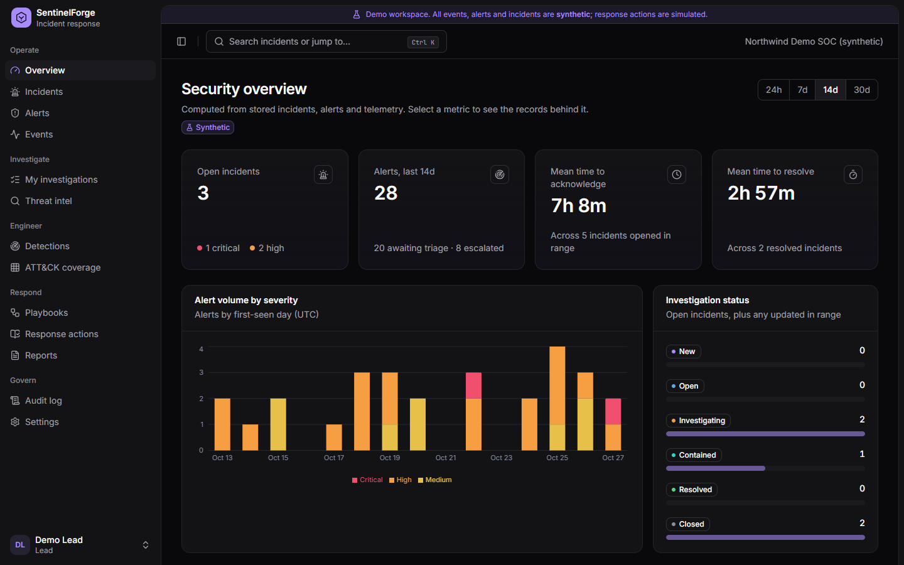
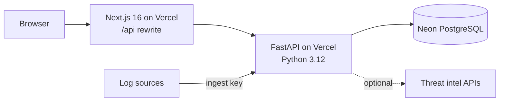

# SentinelForge IR

**Incident response and security engineering platform**: ingest telemetry, detect with tested
rules, triage deduplicated alerts, investigate incidents with evidence and threat intelligence,
run approval-gated (simulated) response playbooks, and export evidence-backed reports.

Built as a portfolio project to demonstrate practical incident response, detection engineering
and secure application engineering. **All demo data is synthetic and every disruptive response
action is simulated.**



## What it does

| Area | Highlights |
|---|---|
| Ingestion | Authenticated per-source API keys, strict validation, idempotent fingerprints, 1 MiB / 500-event batches; native Microsoft formats (Entra ID sign-in and audit logs, Defender XDR alerts, Windows Security/Sysmon events) with ready-made shippers ([guide](docs/connectors-microsoft.md)) |
| Detection | Seven documented rules (brute force, LOLBins, privileged account creation, log tampering, suspicious egress, phishing click, forwarded Microsoft alerts) with labelled fixtures and an honest self-test (TP/FP/TN/FN, precision, recall, known misses) |
| Alert triage | Dedup-safe alerts with rule rationale, false-positive notes and matching events; acknowledge, close with disposition, or escalate |
| Incidents | Lifecycle state machine (New → Open → Investigating → Contained → Resolved → Closed, lead-only reopen), optimistic concurrency, merged timeline, append-only notes, hashed evidence with provenance |
| Threat intel | IOC normalisation (incl. defanged input), VirusTotal / AbuseIPDB / OTX / [NepSec Intel](https://nepsecintel.kuinkel.com) adapters with caching and rate-limit handling, local sightings, analyst verdict kept separate from provider findings |
| Response | Seven playbooks; firewall block is simulated and needs approval from a *different* lead; internal addresses refused; idempotency keys |
| ATT&CK | Coverage view with tested/untested/gap states, observed alerts and last test time, plus an explicit disclaimer |
| Reporting | JSON, Markdown and print-to-PDF reports that quote analyst text verbatim and list limitations |
| Governance | Role-based access (viewer, analyst, lead, admin), organisation isolation, append-only audit log enforced by a database trigger |

## Architecture



Next.js (App Router, TypeScript strict, Tailwind v4, Radix, Recharts, TanStack Query) and
FastAPI (Pydantic, SQLAlchemy 2, Alembic, psycopg 3, argon2). Details:
[docs/architecture.md](docs/architecture.md).

## Run locally (no Docker)

Prerequisites: Python 3.12, Node 24, Git.

```bash
# Backend
cd backend
python -m venv .venv
.venv/Scripts/activate            # Windows; use `source .venv/bin/activate` elsewhere
pip install -r requirements-dev.txt
python scripts/local_pg.py        # starts a local PostgreSQL (pgserver) and prints its URL
cp .env.example .env              # set DATABASE_URL to the printed URL, COOKIE_SECURE=false, DEMO_MODE=true
python -m alembic upgrade head
python -m app.cli seed-demo       # optional: first demo sign-in also seeds it
python -m uvicorn app.main:app --port 8000

# Frontend (second terminal)
cd frontend
npm ci
cp .env.example .env.local
npm run build && npm start        # http://127.0.0.1:3000
```

Open `/login` and choose a demo role. To create a real (password) account instead:

```bash
python -m app.cli create-org --name "My SOC" --slug mysoc
python -m app.cli create-user --org mysoc --email you@example.com --name "You" --role admin   # prompts for a password
```

On Windows machines with Application Control enabled, `next dev` hot reload may fail to
connect; the production build (`npm run build && npm start`) works. SQLAlchemy's optional C
extensions are skipped automatically on Windows for the same reason.

## Tests

```bash
cd backend  && python -m pytest                    # 105 tests against real PostgreSQL
cd frontend && npm run lint && npm run typecheck && npm test   # 23 unit/component tests
cd frontend && npm run test:e2e                    # 10 Playwright tests incl. axe WCAG scans
```

CI (`.github/workflows/ci.yml`) runs all of the above plus `pip-audit`, `npm audit` and gitleaks.
See [docs/testing.md](docs/testing.md).

## Deploy (free tiers)

Vercel Hobby (two projects: `backend/`, `frontend/`) + Neon Free. Step-by-step instructions,
environment variables, migrations, rollback and troubleshooting:
[docs/deployment.md](docs/deployment.md). Limits and what they mean:
[docs/free-tier-limitations.md](docs/free-tier-limitations.md).

## Demo

A five-minute walkthrough and three case studies: [docs/portfolio-demo.md](docs/portfolio-demo.md).

## Documentation

| Document | Contents |
|---|---|
| [ui-research.md](docs/ui-research.md) | Six reviewed products, adopted/adapted/rejected patterns |
| [design-system.md](docs/design-system.md) | Tokens, components, accessibility |
| [architecture.md](docs/architecture.md) | Components, data flow, tenancy |
| [database-schema.md](docs/database-schema.md) | Tables, constraints, ER diagram |
| [api.md](docs/api.md) | Endpoints, roles, ingestion format |
| [threat-model.md](docs/threat-model.md) | STRIDE by trust boundary |
| [security-controls.md](docs/security-controls.md) | Controls mapped to code and tests |
| [detection-coverage.md](docs/detection-coverage.md) | Rules, evaluation results, limitations, gaps |
| [incident-runbooks.md](docs/incident-runbooks.md) | Rule-aligned response procedures |
| [testing.md](docs/testing.md) | Test suites and recorded results |
| [connectors-microsoft.md](docs/connectors-microsoft.md) | Sending Entra ID, Defender and Windows logs |
| [deployment.md](docs/deployment.md) | Vercel + Neon setup, migrations, rollback |
| [free-tier-limitations.md](docs/free-tier-limitations.md) | Verified limits and implications |
| [portfolio-demo.md](docs/portfolio-demo.md) | Walkthrough and case studies |

## Implemented vs planned

**Implemented and tested:** everything in the tables above.

**Planned / not implemented:** MFA or SSO; real (non-simulated) containment integrations; Sigma
rule conversion; frequency-based beacon detection; background job queue for large ingests;
scheduled demo reset; light theme.

## Limitations

A free-tier portfolio deployment: no SLA, cold starts, one hour of platform logs, 0.5 GB of
database storage. Detection metrics come from small hand-written fixtures. Do not use this to
protect real systems.
