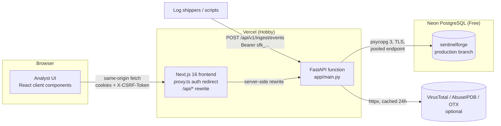
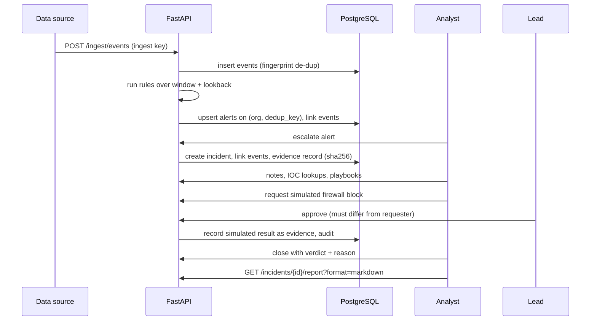

# Architecture

SentinelForge IR is a two-tier web application: a Next.js analyst interface and a FastAPI
backend, sharing one PostgreSQL database hosted on Neon. Everything runs on free tiers and
needs no Docker.

## Request path

1. The browser only talks to the frontend origin. `next.config.ts` rewrites `/api/*` to the
   backend (`BACKEND_URL`, a server-only variable), so session cookies are first-party and the
   backend address is never sent to the browser.
2. `src/proxy.ts` (Next.js 16's renamed middleware) redirects requests without a session cookie
   to `/login`. This is a convenience only.
3. Every API request is authorised in the backend (`app/deps.py`): the hashed session token is
   looked up server-side, CSRF is checked on mutations, roles are enforced, and every query is
   filtered by the caller's organisation.

## Backend modules

| Module | Responsibility |
|---|---|
| `app/models.py` | SQLAlchemy 2 models: tenants, telemetry, alerts, incidents, evidence, intel, response, audit |
| `app/deps.py`, `app/security.py` | Sessions (argon2id passwords, opaque tokens stored as SHA-256), CSRF, role checks |
| `app/detection/` | Rule framework, six rules, labelled fixtures, ATT&CK reference, engine with dedup-safe upserts |
| `app/intel/` | IOC normalisation, provider adapters, caching, local sightings |
| `app/playbooks/` | Read-only and simulated playbooks, approval workflow with separation of duties |
| `app/services/` | Ingestion, incident lifecycle and timeline, reports, synthetic scenarios, demo seed/reset |
| `app/routers/` | Versioned REST API under `/api/v1` |
| `alembic/` | Schema migrations, including the append-only audit trigger |

## Data flow: event to closed incident

## Key design decisions

- **Serverless-friendly state.** Sessions, rate-limit counters and caches live in Postgres
  because serverless instances share no memory. Nothing is written to the function filesystem.
- **Connection handling.** psycopg 3 with server-side prepared statements disabled
  (`prepare_threshold=None`) for Neon's PgBouncer pooler, `pool_pre_ping` and a short recycle
  window to survive compute auto-suspend. Migrations use the direct (unpooled) URL.
- **Deterministic detection.** Rules are Python classes evaluated over normalised `EventView`
  objects, so the same code runs on database rows and on labelled fixtures.
- **Idempotency.** Event fingerprints, alert dedup keys and playbook idempotency keys make
  retries safe.
- **Honest data.** Unconfigured providers report "unconfigured"; MTTA/MTTR report "No data"
  without samples; synthetic records are flagged at every layer.

## Tenancy model

Each user belongs to one organisation. All tenant-owned tables carry `org_id`; lookups by ID
always include the caller's `org_id` and return 404 (not 403) for other tenants, so existence is
not revealed. Detection rule metadata and playbook definitions are platform-wide.
