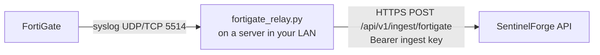

# FortiGate firewall

FortiGate can only send logs as **syslog**, and SentinelForge's API runs on Vercel, which
cannot receive syslog. A small relay inside your network bridges the two:



## What is used

| FortiGate log | Becomes | Detection |
|---|---|---|
| `event / vpn`: SSL-VPN login failures (`ssl-login-fail`) and tunnels up | `auth.failure` / `auth.success` (user, remote IP) | **SF-AUTH-001**: VPN password guessing that succeeds |
| `event / system`: administrator login success / failure | `auth.success` / `auth.failure` | SF-AUTH-001 against the firewall itself |
| `traffic`: accepted sessions | `network.connection` (source host, destination IP/port, bytes sent) | **SF-NET-001**: unusual ports, large uploads, watchlisted IPs |
| `utm / dns` | `dns.query` | SF-MAIL-001 (phishing link followed) |
| `utm / webfilter` | `proxy.request` (full URL) | SF-MAIL-001 |
| `utm / ips`, `anomaly`, `virus`, blocked `app-ctrl` | `security.alert` (severity from FortiGate) | **SF-EXT-001**: medium/high become alerts |

Denied sessions, configuration changes and other logs are skipped and counted. Both the
default `key=value` format and `set format json` are understood.

## 1. Create a data source

Settings → Data sources → **Add source**, type `fortigate`, e.g. "FortiGate HQ". Copy the
ingest key (shown once). Revoke or rotate it on the same page.

## 2. Run the relay

Any always-on machine in the LAN that the FortiGate can reach (a small Linux VM, a Windows
server, a Raspberry Pi). Python 3.10+, no extra packages.

```bash
export SENTINELFORGE_URL=https://sentinelforge-api.kuinkel.com
export SENTINELFORGE_INGEST_KEY=sfk_...            # from step 1
python3 connectors/fortigate/fortigate_relay.py --allow 192.168.1.99   # the FortiGate's source IP
```

Windows (PowerShell):

```powershell
$env:SENTINELFORGE_URL = "https://sentinelforge-api.kuinkel.com"
$env:SENTINELFORGE_INGEST_KEY = "sfk_..."
python connectors\fortigate\fortigate_relay.py --allow 192.168.1.99
```

- `--allow` lists the FortiGate source addresses; packets from anything else are dropped,
  so nobody else on the network can inject fake firewall logs.
- Open UDP **and** TCP 5514 in the relay host's firewall (or choose `--port`).
- `--traffic interesting` (default) forwards only accepted sessions to public addresses on
  non-standard ports or with more than 10 MiB sent. Every VPN, admin, DNS, web-filter and
  IPS log is always forwarded. Use `--traffic all` for every session (high volume; the free
  database tier is 0.5 GB) or `--traffic none`.
- The relay batches every 5 s (max 200 lines), retries while SentinelForge is unreachable
  (buffering up to 50 000 lines in memory) and prints counters every 5 minutes.

Keep it running as a service: a systemd unit on Linux, or on Windows a scheduled task
"At startup" running `python fortigate_relay.py --allow ...` with the two environment
variables set at machine level.

## 3. Point the FortiGate at the relay

FortiOS CLI (7.x; replace `192.168.1.50` with the relay's address):

```
config log syslogd setting
    set status enable
    set server "192.168.1.50"
    set port 5514
    set mode udp            # or "reliable" for TCP with octet framing
    set format default      # "json" also works
    set facility local7
end
config log syslogd filter
    set severity information
    set forward-traffic enable
    set local-traffic disable
    set multicast-traffic disable
    set sniffer-traffic disable
    set anomaly enable
    set voip disable
end
```

GUI: **Log & Report → Log Settings → Remote Logging and Archiving → Send logs to syslog**,
IP of the relay, then set the port and mode in the CLI as above (the GUI uses port 514).

Make sure the policies you care about log: **Policy & Objects → Firewall Policy →** each
policy's **Log Allowed Traffic** = *All Sessions* (or *Security Events*), and enable logging
in the DNS filter, web filter and IPS profiles applied to them. SSL-VPN and admin login
events are logged by default.

If the FortiGate sends from a VDOM or management interface, set the source:
`config log syslogd setting` → `set source-ip <interface IP>` and use that IP in `--allow`.

## 4. Check it works

1. Settings → Data sources: "FortiGate HQ" turns *Reporting* within a minute.
2. Events: filter by source; you should see `auth.*`, `dns.query`, `network.connection` rows.
3. Test: three or more wrong SSL-VPN passwords then a correct one from the same IP within ten
   minutes raises **SF-AUTH-001** (it needs five failures).

## Troubleshooting

| Symptom | Check |
|---|---|
| Relay prints `rejected_source` > 0 | The FortiGate sends from a different IP: add it to `--allow` or set `source-ip`. |
| `received` stays 0 | FortiGate cannot reach the relay: `diagnose sniffer packet any 'port 5514' 4` on the FortiGate; host firewall on the relay. |
| `HTTP 401` from SentinelForge | Wrong or revoked ingest key; rotate it in Settings. |
| Events arrive but no traffic | Policies do not log, or `--traffic interesting` filtered routine HTTPS (expected). |

Verified on 27 October 2026 with FortiOS-format sample lines (key=value and JSON), mapping
covered by `backend/tests/test_fortigate.py`, and the relay run end to end against a local
API. Not yet run against a physical FortiGate from this environment.
