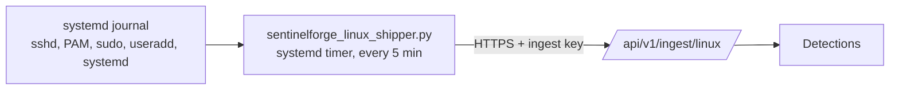

# Connecting Ubuntu Server and Ubuntu Desktop

SentinelForge reads security events from the **systemd journal**, which every Ubuntu release
since 16.04 uses on both Server and Desktop. A small shipper runs on each machine every five
minutes and posts new records to the API. Nothing listens on the machine and no inbound port
is opened.

A step-by-step guide with screenshots for Ubuntu Desktop, Ubuntu Server and Windows is in the
[Endpoint Connection Manual (PDF)](manual/SentinelForge-IR-Endpoint-Connection-Manual.pdf).



| What happens on the machine | Event | Detection |
|---|---|---|
| SSH `Failed password` and `Accepted password` or `publickey` (`sshd`, `sshd-session`) | `auth.failure`, `auth.success` with source IP | SF-AUTH-001 password guessing that succeeds |
| Desktop sign-in at the GDM/LightDM/SDDM greeter, console `login`, failed `su`/`sudo`/polkit password | `auth.failure`, `auth.success` (no source IP for local sign-ins) | Recorded for investigations |
| `sudo` command (`COMMAND=...`), `user NOT in sudoers` | `process.start` (parent `sudo`), `auth.failure` (outcome `denied`) | Investigations; SF-PROC-001 patterns |
| `useradd`, `usermod -aG`, `gpasswd -a`, `adduser USER GROUP` | `iam.user_created`, `iam.group_member_added` (the `sudo` user who ran it is named as the actor) | SF-IAM-001 for `sudo`, `admin`, `wheel`, `docker`, `lxd` |
| `auditd`, `rsyslog`, `syslog-ng`, `systemd-journald`, Wazuh, osquery, Defender, Falcon, `ufw`, AppArmor, fail2ban, ClamAV stopped | `service.stopped` | SF-DEF-001 for the logging services. Stops during a shutdown or reboot are ignored |

Supported: Ubuntu 20.04, 22.04, 24.04 and later (Server and Desktop), and other systemd
distributions (Debian, RHEL family) with the same log formats. Requirements: `python3`
(installed by default on Ubuntu) and outbound HTTPS to the API.

## 1. Create a data source

Settings → Data sources → **Add source** (admin). Type **`linux`**, name it after the machine
(for example `ubuntu-srv-01`). Copy the ingest key; it is shown once. Use one source per
machine so Telemetry health shows each machine separately.

## 2. Install the shipper (same steps on Server and Desktop)

Copy the two files in `connectors/linux` to the machine (for example with
`scp -r connectors/linux user@server:~/sentinelforge`), or, if the repository is public to you,
download them:

```bash
sudo apt install -y python3 curl     # already present on standard Ubuntu installs
mkdir -p ~/sentinelforge && cd ~/sentinelforge
base=https://raw.githubusercontent.com/rk528/nepsec-SentinelForge-IR/main/connectors/linux
curl -fsSLO "$base/install.sh" && curl -fsSLO "$base/sentinelforge_linux_shipper.py"
less install.sh                      # read what it does before running it as root
sudo bash install.sh --api-url https://sentinelforge-api.kuinkel.com
```

The installer asks for the ingest key (the input is hidden). It:

- creates a locked system account `sentinelforge` that can read the journal and nothing more
  (member of `systemd-journal` only; no shell, no home, no sudo);
- installs the shipper to `/opt/sentinelforge/`;
- writes the URL and key to `/etc/sentinelforge/linux-shipper.env` (`root:sentinelforge`,
  mode `0640`), never on a command line;
- installs `sentinelforge-shipper.service` (hardened: `ProtectSystem=strict`,
  `NoNewPrivileges`, no capabilities) and a timer that runs it every five minutes;
- sends the last 60 minutes of events straight away and prints the result.

On a server reached over SSH, run it inside your SSH session. On a desktop, open
**Terminal** (Ctrl+Alt+T) and run the same commands.

## 3. Check it works

```bash
systemctl list-timers sentinelforge-shipper.timer      # next run time
journalctl -u sentinelforge-shipper.service -n 20      # "read N journal records, sent M, ..."
sudo -u sentinelforge python3 /opt/sentinelforge/sentinelforge_linux_shipper.py --dry-run --lookback-minutes 30
```

`--dry-run` prints the records that would be sent without sending them or moving the
cursor. In SentinelForge, the source shows **Reporting** in Settings → Data sources, and
Events filtered by host shows the machine's events.

A safe end-to-end test from another machine: try `ssh wronguser@<server>` five or six times
with a bad password, then sign in successfully as a real user from the same address. After
the next run (up to five minutes) an SF-AUTH-001 alert appears.

## Operations

| Task | Command |
|---|---|
| Run now | `sudo systemctl start sentinelforge-shipper.service` |
| Rotate the ingest key | Rotate it in Settings, then `sudoedit /etc/sentinelforge/linux-shipper.env` |
| Re-send history | `sudo rm /var/lib/sentinelforge/journal.cursor` (re-reads the last 60 minutes; duplicates are dropped by the API) |
| Uninstall | `sudo bash install.sh --uninstall` |

The shipper remembers the journal cursor of the last record it delivered. If the API is
unreachable or returns an error, the cursor does not move and the next run retries from the
same place, so nothing is lost while the journal retains it (Ubuntu keeps it on disk by
default under `/var/log/journal`).

## Recommended host settings

- **Persistent journal:** standard Ubuntu installs keep it in `/var/log/journal`. On minimal
  or cloud images, `sudo mkdir -p /var/log/journal && sudo systemctl restart systemd-journald`.
- **SSH:** `PasswordAuthentication no` is safer; failures are still logged for key and
  invalid-user attempts, but SF-AUTH-001 needs password logins to fire.
- **Command lines beyond sudo:** process execution by non-sudo users is not in the journal.
  Install `auditd` with an `execve` rule if you need it (see limitations).

## Limitations

- Only events written to the journal are seen. Plain process execution, file access and
  network connections need auditd or an EDR, which this connector does not parse yet.
- Local desktop sign-ins carry no source IP, so SF-AUTH-001 (which keys on account and source
  address) only fires for remote logins such as SSH.
- The actor of `useradd`/`usermod` is taken from a `sudo` command on the same host in the two
  minutes before; changes made from a root shell show no actor.
- A service restarted by a package upgrade logs a stop and raises SF-DEF-001 (documented
  false positive for that rule).
- Message formats were written against OpenSSH, linux-pam, sudo, shadow-utils and systemd
  output on Ubuntu and tested with recorded-format fixtures; they have not yet been run
  against a live Ubuntu host from this environment.
