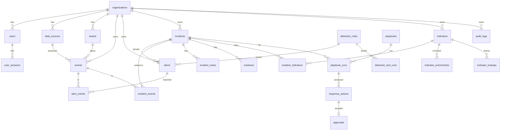

# Database schema

PostgreSQL (Neon), managed with Alembic (`backend/alembic/versions`). All timestamps are
`timestamptz` and stored in UTC. Primary keys are UUIDs except where a natural key is clearer
(rule IDs such as `SF-AUTH-001`, playbook IDs, rate-limit keys).



## Tables

| Table | Purpose | Notable constraints and indexes |
|---|---|---|
| `organizations` | Tenants; `is_demo` marks the synthetic workspace; `incident_seq` allocates `INC-nnnn` atomically | unique `slug` |
| `users` | Accounts, role, argon2id hash (NULL for demo users) | unique `lower(email)`; role CHECK |
| `user_sessions` | Server-side sessions; only SHA-256 of token and CSRF token stored | unique `token_hash` |
| `data_sources` | Telemetry sources; SHA-256 of ingest key and a short prefix | unique per org name and key hash |
| `assets` | Hosts seen in telemetry, last telemetry time | unique `(org_id, hostname)` |
| `events` | Normalised events plus untrusted `raw` JSONB | unique `(org_id, fingerprint)`; indexes on time, type+time, host, user, src/dst IP, domain |
| `detection_rules` | Metadata mirror of rules in code, `enabled` flag | severity CHECK |
| `detection_test_runs` | Self-test metrics per run (TP/FP/TN/FN, precision, recall, latency, cases) | index `(rule_id, run_at)` |
| `alerts` | Deduplicated detections; severity and confidence kept separate; disposition | unique `(org_id, dedup_key)`; CHECKs on enums |
| `alert_events` | Events that triggered each alert | composite PK |
| `incidents` | Lifecycle, verdict, closure, timestamps for MTTA/MTTR, optimistic `version` | unique `(org_id, number)`; CHECK: closed ⇒ verdict and closure reason |
| `incident_events` | Events linked as evidence, with who and why | composite PK |
| `incident_notes` | Append-only analyst/assessment/system notes | |
| `evidence` | Immutable records with provenance JSON and SHA-256 of content | |
| `indicators` | IOCs with the analyst's own verdict | unique `(org_id, ioc_type, value)` |
| `indicator_enrichments` | Provider results with status, reported verdict and cache expiry | status CHECK |
| `indicator_lookups` | Investigation history | |
| `incident_indicators` | IOC ↔ incident links | composite PK |
| `playbooks` | Playbook catalogue (synced from code) | |
| `playbook_runs` | Runs with idempotency key and output | unique `(org_id, idempotency_key)` |
| `response_actions` | Requested actions, parameters, status, simulation flag, rollback plan | unique `(org_id, idempotency_key)` |
| `approvals` | One decision per action, decider and reason | unique `response_action_id` |
| `audit_logs` | Append-only security audit trail | trigger blocks UPDATE/DELETE |
| `rate_limit_buckets` | Fixed-window counters shared by serverless instances | |

## Append-only audit log

Migration `0001` installs `audit_logs_append_only()` as a `BEFORE UPDATE OR DELETE` trigger.
The only exception is the demo reset, which sets the transaction-local setting
`sentinelforge.allow_audit_purge = 'demo-reset'` before deleting the demo organisation.

## Transactions

Each request uses one session and commits once; audit records are written in the same
transaction as the change they describe. Multi-record operations (escalation, playbook runs,
approvals, ingestion with detection) are atomic. Rate-limit counters commit separately so
that failed attempts still count.

## Seed and reset

```bash
python -m app.cli seed-demo                 # synthetic workspace (also done on first demo sign-in)
python -m app.cli reset-demo                # asks for "RESET DEMO DATA"; demo org only
```

The seed contains no credentials: demo users have no password and can sign in only while
`DEMO_MODE=true`.
