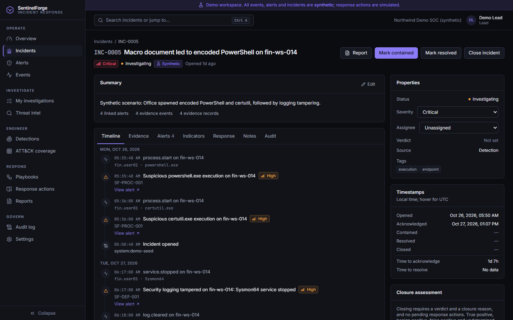
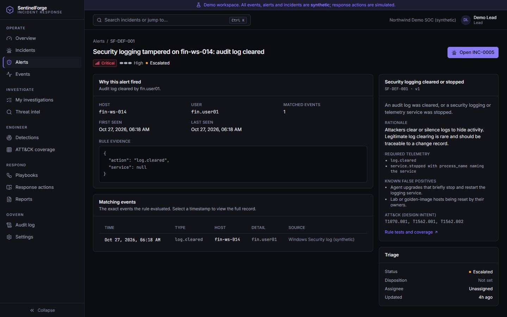
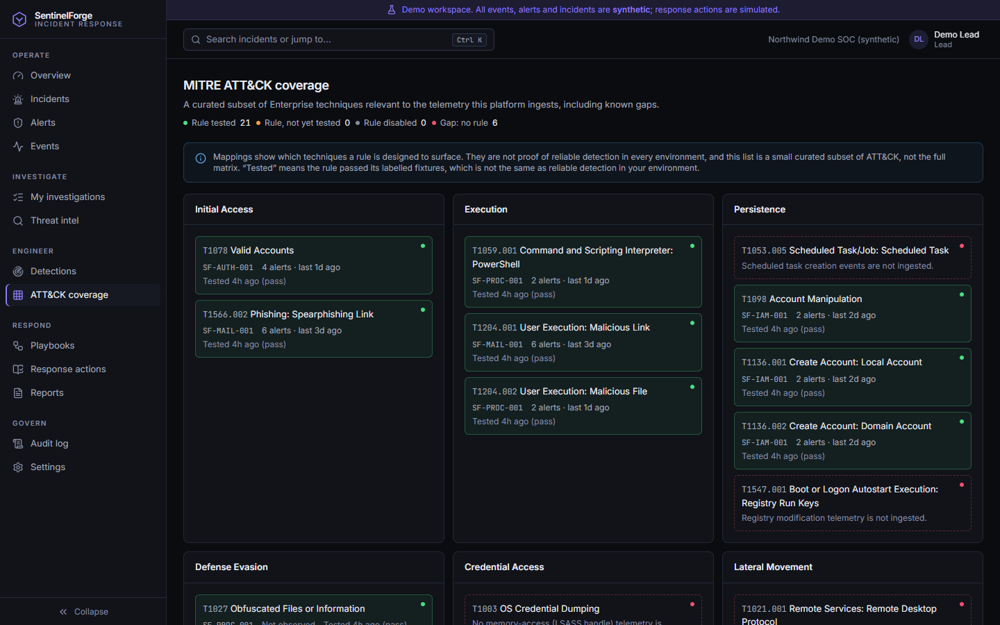

# Portfolio demo guide

A five-minute walkthrough of the synthetic demo, followed by three case studies. All data is
synthetic: addresses come from documentation ranges (RFC 5737), domains use reserved TLDs
(`.example`, `.test`), and account names are generic. Response actions are simulated.

## Walkthrough

1. **Sign in** at `/login` → *Explore the synthetic demo* → **Analyst**.
2. **Overview:** switch the time range; select *Open incidents* or a rule in *Detections by
   rule* to see the records behind the number. MTTA/MTTR state their sample size.
3. **Alert queue:** filter by rule; open an alert to see why it fired, the rule's rationale and
   false positives, and the exact matching events.
4. **Incident INC-0005** (macro → PowerShell): Timeline merges telemetry, alerts, status changes
   and notes. Evidence shows hashed evidence records with provenance. Run *Collect related
   evidence* and *Enrich associated IOCs* on the Response tab.
5. **Incident INC-0003** (password guessing): a simulated firewall block is pending. Sign out,
   sign in as **Lead** and approve it from the Response tab. The requesting analyst could not
   approve it themselves.
6. **Detections:** run the self-test and expand a rule to see TP/FP/TN/FN and known limitations.
7. **ATT&CK coverage:** tested techniques, observed alerts and explicit gaps.
8. **Reports:** open INC-0001 and export Markdown or JSON, or print to PDF.
9. **Settings → Synthetic scenarios:** inject a scenario and watch new alerts appear.

## Case study 1: Invoice phishing (INC-0001)

- **Signal:** SF-MAIL-001 correlated an invoice email (SPF fail) with a DNS query and proxy
  request to the same domain seven minutes later from the recipient's host.
- **Investigation:** proxy events showed a single GET and no POST, so credentials were probably
  not submitted.
- **Response:** message purge and domain block (recorded); lead assessment added.
- **Outcome:** closed **true positive**.
- **Engineering point:** the same rule also fired on a wanted newsletter (INC-0002, closed
  **benign positive**). The fixture suite records this as a known false positive rather than
  hiding it, which is why the rule's precision on fixtures is 0.5.

## Case study 2: VPN password guessing (INC-0003)

- **Signal:** SF-AUTH-001: nine failures from `203.0.113.45`, then a successful VPN session.
- **Investigation:** the source has no prior history; the user was not expected to be online.
- **Response:** the analyst marked the IP malicious (which adds it to the network rule's
  watchlist) and requested a simulated egress block. Approval requires a different lead; the
  server refuses internal or reserved addresses.
- **Engineering point:** separation of duties and idempotent, auditable response actions.

## Case study 3: Macro document to defence evasion (INC-0005)

- **Signal:** SF-PROC-001 (Word spawning encoded PowerShell, then certutil download) and
  SF-DEF-001 (Sysmon stopped, Security log cleared) on the same host, grouped into one
  critical incident.
- **Investigation:** related-event pivots show the DNS lookup of the staging domain and an
  outbound connection on port 4444 (SF-NET-001).
- **Engineering point:** pattern-specific ATT&CK attribution (T1059.001, T1105, T1204.002,
  T1070.001) and a documented gap: obfuscation without `-enc` is a known miss.

## Screenshots

Captured from the running application (production build, synthetic demo):
`docs/screenshots/`.

| Overview | Incident detail |
|---|---|
|  |  |
| **Alert detail** | **ATT&CK coverage** |
|  |  |
