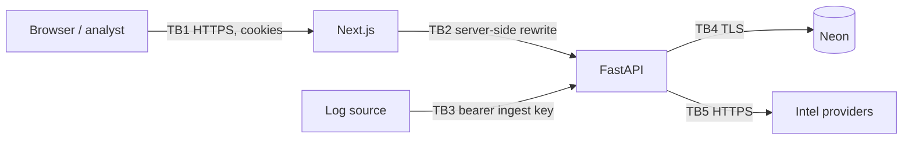

# Threat model

Scope: the SentinelForge IR web application (frontend, API, database) as deployed for a
portfolio demonstration. Method: STRIDE per trust boundary.

## Assets

1. Incident records, notes and evidence (integrity matters most: they drive decisions).
2. Audit trail (must be tamper-evident).
3. Credentials: password hashes, session tokens, ingest keys, provider API keys, DB URLs.
4. Telemetry, including untrusted raw log payloads.
5. Approval workflow for response actions.

## Trust boundaries

## Threats and mitigations

| # | Boundary | STRIDE | Threat | Mitigation | Residual risk |
|---|---|---|---|---|---|
| 1 | TB1 | Spoofing | Credential stuffing / guessing | argon2id, per-account and per-IP rate limits, generic errors, audit of failures | No MFA |
| 2 | TB1 | Spoofing | Session theft via XSS | HttpOnly cookies, React escaping, untrusted data rendered as text, CSP | `'unsafe-inline'` scripts allowed |
| 3 | TB1 | Tampering | CSRF on state-changing requests | Per-session CSRF header, SameSite=Lax | Low |
| 4 | TB1 | Elevation | IDOR: changing IDs to reach another tenant | All lookups include `org_id`; 404 on mismatch; tests cover reads and writes | Low |
| 5 | TB1 | Elevation | Analyst approves own containment action | Lead role required; requester ≠ approver enforced server-side | Two colluding leads |
| 6 | TB1 | Repudiation | Analyst denies an action | Audit log with actor, IP, request ID; DB trigger prevents edits | DB owner could disable the trigger |
| 7 | TB3 | Spoofing | Forged telemetry | Per-source keys stored hashed, rotatable; ingest audited | Stolen key can inject events for that source |
| 8 | TB3 | DoS | Oversized or rapid batches | 1 MiB body, 500 events, per-source rate limit | Free-tier quotas can be exhausted |
| 9 | TB3 | Tampering | Malicious content in logs (XSS, injection, prompt injection) | Stored as JSONB via bound parameters, rendered as inert text, never executed or used as instructions | Low |
| 10 | TB4 | Info disclosure | DB credential leak | Env vars only, gitleaks in CI, no secrets in frontend bundle | Operator error |
| 11 | TB5 | Tampering | Misleading provider data treated as truth | Provider verdicts labelled and timestamped, kept separate from analyst verdicts; absence ≠ safe | Analysts may still over-trust providers |
| 12 | API | DoS | Expensive queries / enumeration | Pagination caps, indexed filters, request limits | Shared free-tier capacity |
| 13 | Response | Tampering | Real infrastructure changed by mistake | All disruptive actions simulated; internal ranges refused | Not applicable until real integrations exist |
| 14 | Demo | Info disclosure | Demo visitors mistaking synthetic data for real | Synthetic banner, badges, reserved IP/domain ranges, generic account names | Low |

## Out of scope

Host and platform security of Vercel and Neon, supply-chain compromise of pinned dependencies
beyond audit tooling, and physical/social-engineering attacks.
